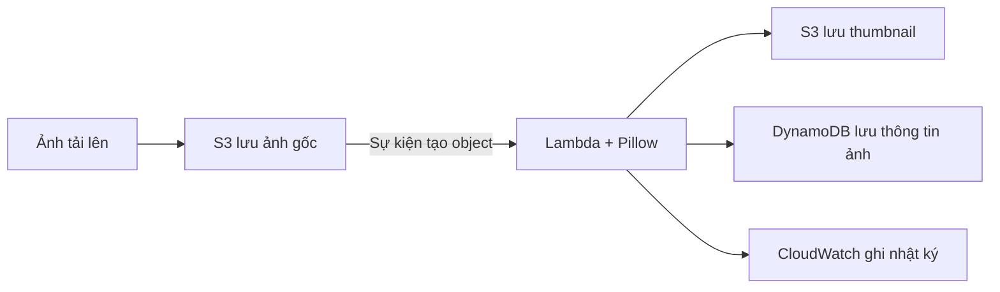

# Cloud Photo

**Xử lý ảnh tự động — tạo thumbnail khi upload lên Amazon S3.**

Cloud Photo là đồ án môn Điện toán đám mây. Dự án xây dựng một hệ thống nhận ảnh gốc và tự động tạo ảnh thu nhỏ để sử dụng trên website hoặc thư viện ảnh. Người dùng chỉ cần tải ảnh lên; hệ thống xử lý, lưu các phiên bản ảnh và ghi lại thông tin để tra cứu.

## Thành viên

| Họ và tên | MSSV |
| --- | --- |
| Bùi Nguyễn Duy Trung | 24110363 |
| Đỗ Anh Tuấn | 24110369 |

Giảng viên hướng dẫn: **TS. Huỳnh Xuân Phụng**.

Khoa Công nghệ Thông tin — Trường Đại học Công nghệ Kỹ thuật TP. HCM.

## Hệ thống làm gì?

- Nhận ảnh JPG/PNG, dung lượng tối đa 10 MiB và không quá 24 triệu pixel.
- Tạo ba ảnh JPEG có cạnh dài tối đa **150, 400 và 1000 pixel**, giữ tỷ lệ và không phóng to ảnh nhỏ.
- Thêm watermark, chuyển nền trong suốt thành nền trắng và loại bỏ metadata EXIF khỏi ảnh kết quả.
- Lưu riêng ảnh gốc và ảnh thu nhỏ trên S3.
- Ghi trạng thái, kích thước và thời gian xử lý vào DynamoDB.
- Cung cấp giao diện Flask để tải ảnh và xem kết quả.

## Cách hoạt động



S3 tiếp nhận ảnh trong thư mục `uploads/` và gửi sự kiện tới Lambda. Hàm xử lý sử dụng Pillow để tạo thumbnail, lưu vào bucket đầu ra và cập nhật DynamoDB. Mỗi ảnh có một mã `image_id` để liên kết ảnh gốc với các phiên bản đã xử lý.

Hai bucket được cấu hình riêng tư. Giao diện Flask đọc thông tin từ DynamoDB và dùng URL ký sẵn có thời hạn để hiển thị ảnh. Luồng xử lý trên là thiết kế tổng thể của dự án.

## Mã nguồn chính

| Thành phần | Tệp | Chức năng |
| --- | --- | --- |
| Xử lý ảnh | [image_tools.py](src/processor/image_tools.py) | Kiểm tra ảnh, tạo ba kích thước và thêm watermark |
| Lambda, S3 và DynamoDB | [lambda_function.py](src/processor/lambda_function.py) | Nhận sự kiện, đọc/ghi ảnh trên S3, cập nhật metadata và xử lý sự kiện trùng |
| Giao diện | [src/web/](src/web/) | Đăng nhập, tải ảnh và xem thư viện ảnh |
| Cấu hình AWS | [aws-resources.json](config/aws-resources.json) | Ghi lại thông số tài nguyên đã thiết lập |
| Kiểm thử | [tests/](tests/) | 19 ca kiểm thử xử lý ảnh, worker và Flask |

Thư mục `scripts/` chứa công cụ tạo ảnh mẫu và đóng gói mã Lambda/Pillow Layer. Dự án sử dụng Python 3.12, Pillow, Boto3, Flask và pytest.

## Chạy kiểm thử

Cài Python 3.12, mở Terminal tại thư mục dự án rồi chạy:

```powershell
py -3.12 -m venv .venv
.\.venv\Scripts\python.exe -m pip install -r requirements-dev.txt
.\.venv\Scripts\python.exe -m pytest tests -q
```

Trên Linux/macOS, dùng `python3.12` để tạo môi trường ảo và `.venv/bin/python` cho các lệnh còn lại.

Bộ kiểm thử gồm **10 ca xử lý ảnh, 5 ca Lambda worker và 4 ca Flask**, tổng cộng **19/19 ca đạt**. Các dịch vụ AWS được giả lập trong kiểm thử nên không cần khóa truy cập AWS. GitHub Actions tự động chạy lại bộ kiểm thử khi có thay đổi mã nguồn.

## Đóng gói Lambda và Pillow Layer

```powershell
.\.venv\Scripts\python.exe scripts/build_packages.py
```

Script tạo hai tệp trong `dist/`:

- `lambda_processor.zip`: mã Lambda, handler `lambda_function.lambda_handler`.
- `pillow_py312_x86_64.zip`: thư viện Pillow dành cho Python 3.12, Linux x86_64.

Worker sử dụng các biến `INPUT_BUCKET`, `OUTPUT_BUCKET`, `TABLE_NAME` và biến tùy chọn `WATERMARK_TEXT`. Thông tin xác thực AWS do môi trường chạy cung cấp.

## Trạng thái hiện tại

Đã thiết lập hai bucket S3, bảng `cloud-photo-metadata` và Pillow Layer trên AWS Academy tại Region `us-east-1`. Cấu hình cụ thể được ghi trong [config/aws-resources.json](config/aws-resources.json).

Mã xử lý ảnh, Lambda worker và Flask đã qua kiểm thử cục bộ. Việc kết nối trigger S3, chạy Lambda với Layer trên AWS và triển khai giao diện là các bước tiếp theo cần hoàn thiện.
